# blender-buildings — Blender en MCP et en API pour modéliser des bâtiments

Modélisation **paramétrique** de bâtiments (immeubles haussmanniens, bureaux, hôtels, logistique, résidentiel,
maisons, tours…) dans **Blender 5.2 LTS**, sans interface graphique, pilotable par :

| Canal | Commande | Pour qui |
|---|---|---|
| **MCP** (Model Context Protocol) | `blender-buildings-mcp` | Claude Code, Claude Desktop, Cursor, tout client MCP |
| **API HTTP** (FastAPI + Swagger) | `blender-buildings-api` | n'importe quelle appli, no-code, scripts |
| **CLI** | `blender-buildings build …` | terminal, CI, batch |
| **Python** | `from blender_buildings import …` | scripts bpy |

Chaque bâtiment est décrit par une **spec JSON** (emprise, étages, fenêtres, toiture, balcons, matériaux…), et
chaque construction renvoie les **métriques immobilières** utiles à Offstone ou à un montage d'opération :
emprise au sol, surface de plancher, surface utile, vitrage, nombre de logements / postes / chambres, CES,
densité et valorisation (€/m²).

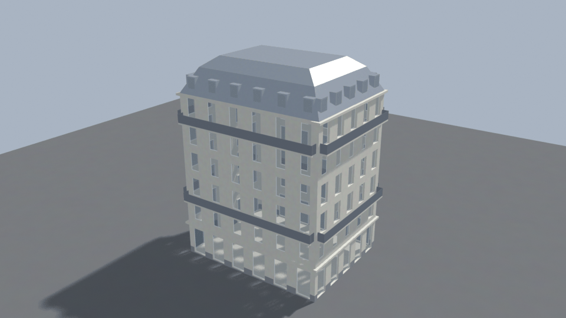

| | | |
|---|---|---|
| 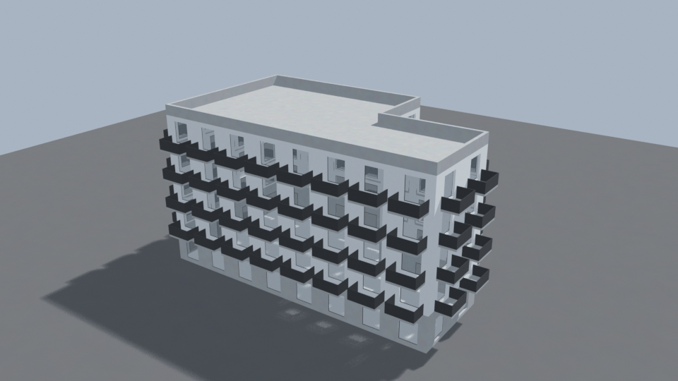 | 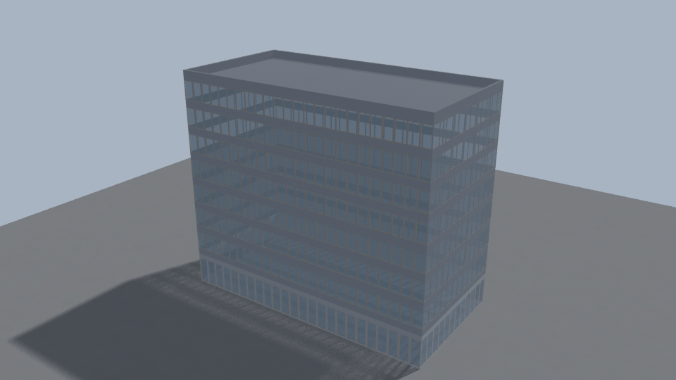 | 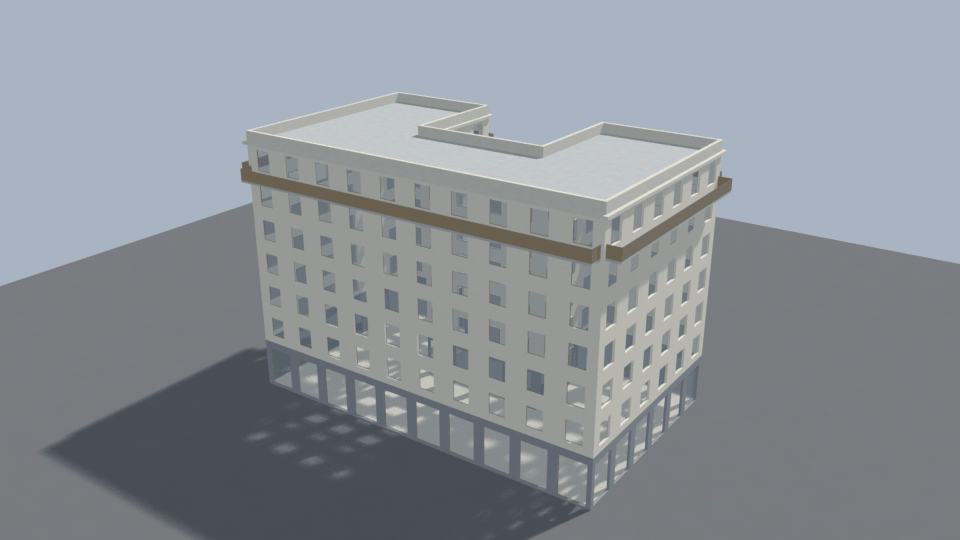 |
| 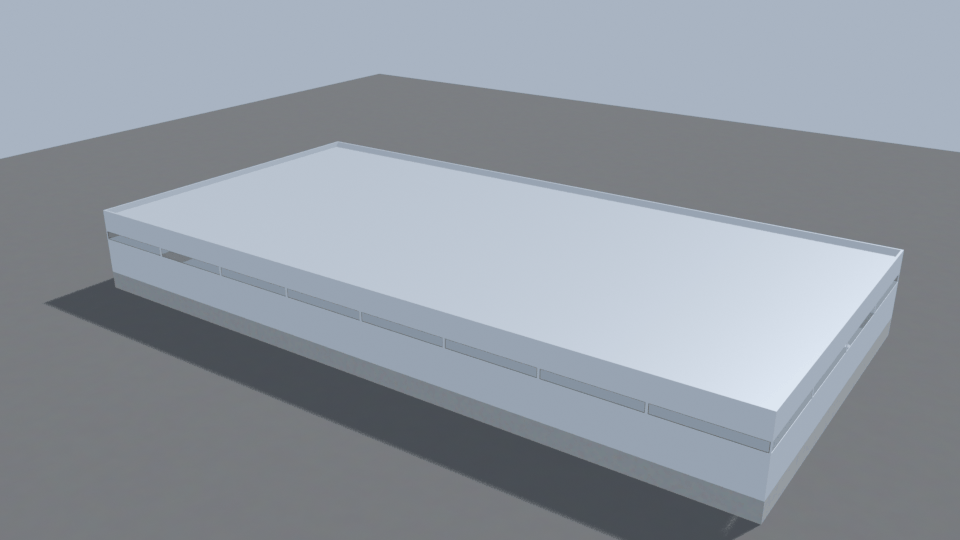 | 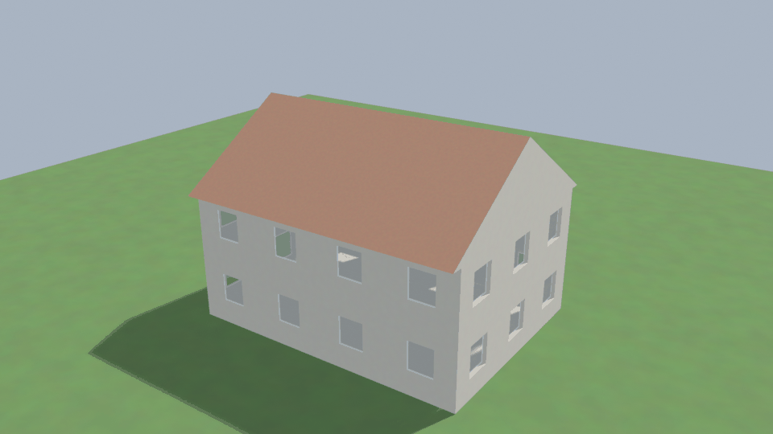 | 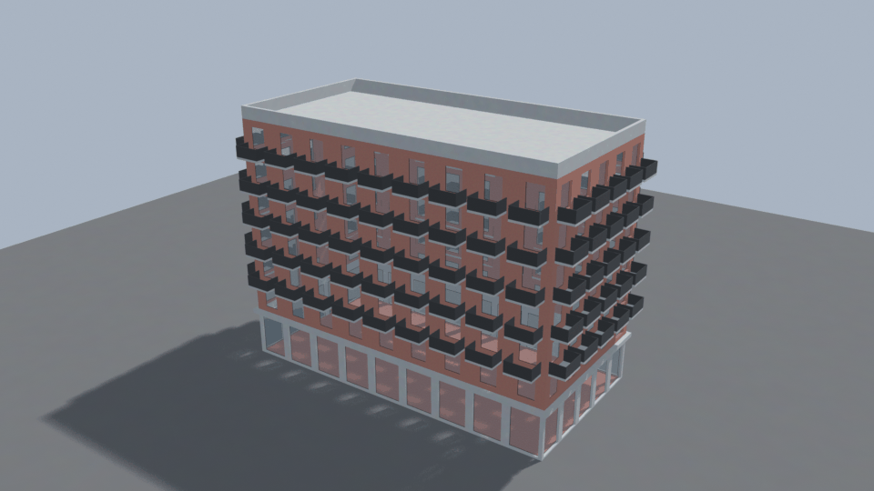 |
| 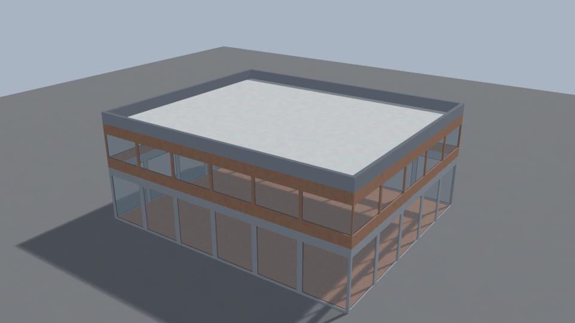 | 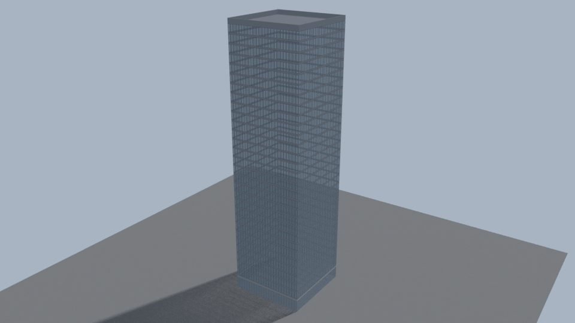 | 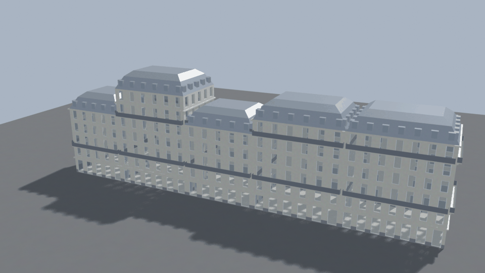 |

Élévations orthographiques automatiques (front / left / top) :

| 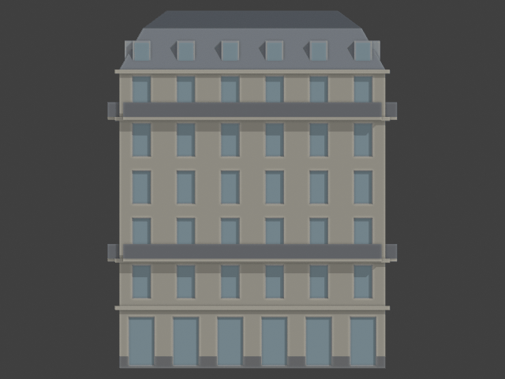 | 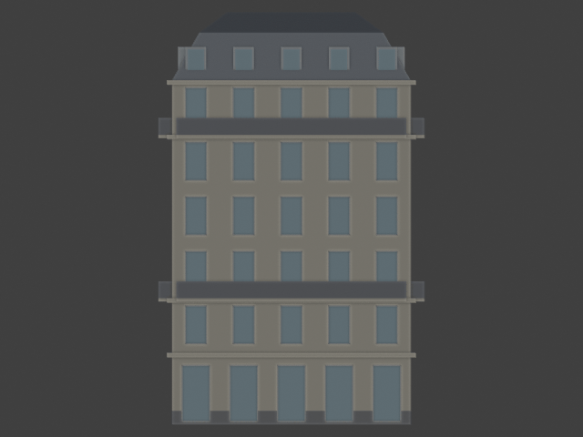 | 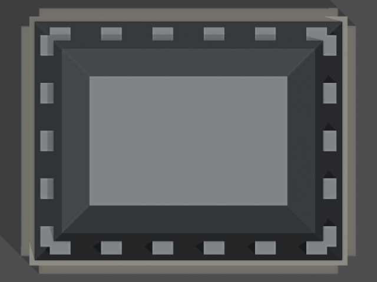 |
|---|---|---|

---

## 1. Ce qui a été téléchargé et installé

| Composant | Version | Où | Rôle |
|---|---|---|---|
| **Blender** (binaire Linux x64, vérifié SHA-256) | 5.2.3 LTS | `/opt/blender/blender` (ou `vendor/blender/` via `scripts/setup.sh`) | backend « binary » du moteur, Blender complet |
| **bpy** (module Python officiel de Blender) | 5.2.3 | `.venv/` (`pip install bpy`) | backend « module » : Blender dans Python, sans binaire |
| **mcp** (SDK officiel Model Context Protocol) | 2.x | `.venv/` | serveur MCP |
| **FastAPI / uvicorn** | — | `.venv/` | API HTTP |
| **mcp-for-blender** (ex `blender-mcp`, ahujasid) | 2.2.6 | `vendor/*.whl`, `vendor/*.tar.gz`, `vendor/blender_mcp_addon.py` | serveur MCP communautaire pour **Blender avec interface** (viewport, PolyHaven, Sketchfab, Hyper3D…) |
| Xvfb + libEGL/libGL | — | système | rendu EEVEE/Cycles headless, add-on GUI sans écran |

Détails et sommes de contrôle : [`vendor/README.md`](vendor/README.md).

Deux serveurs MCP complémentaires sont donc disponibles :

* **`blender-buildings`** (ce dépôt) — headless, déterministe, orienté bâtiments et métriques. Fonctionne sur un serveur
  sans écran, en CI, dans un conteneur.
* **`blender`** (mcp-for-blender) — pilote un Blender ouvert avec son interface (exécution de code, captures du viewport,
  import d'assets). À utiliser sur votre poste quand vous voulez voir et retoucher la scène à la main.

Les deux sont déclarés dans [`../.mcp.json`](../.mcp.json) à la racine du dépôt : Claude Code les voit automatiquement.

## 2. Installation

```bash
cd blender
scripts/setup.sh            # Blender 5.2.3 + .venv (Python 3.13) + bpy + MCP + API + tests
# options : --system (binaire dans /opt/blender) · --skip-blender (module bpy seul) · --skip-venv
.venv/bin/blender-buildings doctor
```

Prérequis : Python **3.13** (imposé par `bpy==5.2.3`), ~1,5 Go d'espace disque. Sur Debian/Ubuntu le script
installe les bibliothèques EGL/GL nécessaires au rendu headless. Sans accès root : `apt-get install libegl1 libgl1 libxi6 libxxf86vm1 libxfixes3 libxrender1 libxkbcommon0 libsm6 libxext6 libgomp1 xvfb`.

## 3. Démarrage rapide

```bash
# Un immeuble haussmannien : GLB + rendu EEVEE
.venv/bin/blender-buildings build --preset haussmann --out output/demo

# Variante : 8 étages, brique, toit à croupes, deux vues
.venv/bin/blender-buildings build --preset haussmann --set floors=8 --set facade.material=brick_red \
    --set roof.kind=hip --formats glb,fbx,png --views perspective,front --out output/variante

# Depuis une spec JSON complète
.venv/bin/blender-buildings build --spec examples/bureaux_la_defense.json --out output/bureaux

# Une rue de 6 immeubles, variés par graine aléatoire
.venv/bin/blender-buildings street --preset haussmann --count 6 --seed 7 --out output/rue

# Métriques seules (sans lancer Blender)
.venv/bin/blender-buildings metrics --preset office --set floors=12 --set site.parcel_area=2500 --set price_per_m2=9000
```

```
Immeuble de bureaux — office — 12 niveaux, 45.3 m
Emprise au sol : 648.0 m² | Surface de plancher : 7776.0 m² | Surface utile : 6609.6 m²
Façades : 4762.8 m² dont vitrage 3281.47 m² (69 %), 792 fenêtres
Volume : 28576.8 m³ | Toiture : parapet
≈ 550 postes de travail
Parcelle 2500.0 m² : CES 0.259, densité 3.11
Valeur estimée : 59 486 400 € (9000.0 €/m²)
```

## 4. Serveur MCP `blender-buildings`

### Lancer

```bash
scripts/run-mcp.sh                       # stdio (Claude Code / Claude Desktop)
scripts/run-mcp.sh --http --port 8765    # Streamable HTTP sur http://127.0.0.1:8765/mcp
scripts/run-mcp.sh --backend binary --blender /opt/blender/blender   # forcer le binaire
scripts/run-mcp.sh --no-python           # désactiver l'outil run_blender_python
```

### Déclarer dans Claude Code

Déjà fait dans `.mcp.json` à la racine du dépôt. Pour un autre projet :

```json
{
  "mcpServers": {
    "blender-buildings": {
      "command": "/chemin/vers/menu-weekend/blender/scripts/run-mcp.sh",
      "env": { "BLENDER_BUILDINGS_OUTPUT": "/chemin/vers/sorties" }
    }
  }
}
```

Claude Desktop : même bloc dans `claude_desktop_config.json`. Cursor / VS Code : idem dans leur fichier MCP.

### Outils

| Outil | Rôle |
|---|---|
| `list_building_presets` | typologies disponibles |
| `get_preset_spec`, `get_spec_schema` | spec JSON d'un preset, schéma complet |
| `compute_building_metrics` | métriques immobilières **sans** construire |
| `build_building` | construit un bâtiment (preset + `overrides` ou spec complète) |
| `build_street` | rue de N bâtiments variés par `seed` |
| `build_block` | îlot : liste de bâtiments positionnés |
| `render_preview` | PNG renvoyé **dans la conversation** (perspective, iso, front, back, left, right, top ; workbench / eevee / cycles) |
| `export_model` | glb, gltf, fbx, obj, stl, usd/usdc/usda, ply, blend |
| `save_blend`, `open_blend` | persistance .blend |
| `scene_info`, `reset_scene`, `delete_objects` | gestion de scène |
| `run_blender_python` | code bpy arbitraire (désactivable) |
| `engine_status` | état du processus Blender, logs |

Ressources : `presets://list`, `presets://{name}`, `spec://schema`. Prompt : `design_building(brief)`.

Exemple de dialogue : *« Construis un R+6 haussmannien de 22 m de façade sur 15 m, avec commerces en RDC,
donne-moi la surface de plancher et le nombre de logements, montre la façade et exporte en GLB. »*

## 5. API HTTP

```bash
scripts/run-api.sh            # http://127.0.0.1:8080/docs (Swagger)
```

```bash
curl -s localhost:8080/presets | jq '.presets[].id'
curl -s -X POST localhost:8080/build -H 'content-type: application/json' \
     -d '{"preset":"hotel","overrides":{"floors":9,"site.parcel_area":1400}}' | jq .summary
curl -s -X POST localhost:8080/render -H 'content-type: application/json' \
     -d '{"view":"front","engine":"workbench","width":1600,"height":900}' | jq .url
curl -s -X POST localhost:8080/export -H 'content-type: application/json' -d '{"format":"glb"}' | jq .url
curl -sO localhost:8080/files/model_1700000000.glb
```

| Méthode | Route | Rôle |
|---|---|---|
| GET | `/health`, `/engine` | état |
| GET | `/presets`, `/presets/{id}`, `/schema`, `/materials` | découverte |
| POST | `/metrics` | métriques sans Blender |
| POST | `/build`, `/street`, `/block` | construction |
| POST | `/render`, `/export`, `/save` | sorties (fichiers servis sous `/files/{nom}`) |
| GET | `/scene` · POST `/reset` · DELETE `/objects` | scène |
| POST | `/python` | code bpy (403 si `BLENDER_BUILDINGS_ALLOW_PYTHON=0`) |

## 6. La spec d'un bâtiment

Toutes les dimensions en mètres. Les champs omis prennent les valeurs par défaut ; les `overrides` acceptent les clés
pointées (`"roof.kind": "mansard"`) ou des dicts imbriqués. Schéma complet : `blender-buildings show --preset haussmann`
ou `GET /schema`.

```jsonc
{
  "name": "Haussmann rue de Rivoli", "use": "residential",          // residential | office | hotel | logistics | retail | mixed
  "footprint": { "kind": "rect", "width": 22, "depth": 15 },        // rect | L | U | polygon (points)
  "floors": 7, "floor_height": 3.1, "basement_levels": 1,
  "ground_floor": { "height": 4.4, "storefront": true, "glazing_ratio": 0.65, "material": "limestone" },
  "windows": { "style": "punched", "width": 1.3, "height": 2.3, "sill": 0.5, "bay_width": 2.9, "recess": 0.25 },
                                                                     // punched | ribbon | curtain | none
  "roof": { "kind": "mansard", "mansard_inset": 1.8, "mansard_height": 2.9, "dormers": true, "material": "zinc" },
                                                                     // flat | parapet | hip | gable | mansard
  "balconies": { "floors": [2, 5], "depth": 0.8, "continuous": true },
  "facade": { "material": "limestone", "base_material": "stone_dark", "cornices": true, "cornice_floors": [1, 2, 5, 7] },
  "site": { "ground": true, "ground_size": 100, "parcel_area": 520 },
  "position": [0, 0, 0], "rotation_deg": 0,
  "unit_average_area": 65, "efficiency_ratio": 0.85, "price_per_m2": 12500
}
```

Matériaux : `limestone`, `render_white`, `render_beige`, `concrete`, `brick_red`, `brick_dark`, `glass`, `glass_tinted`,
`zinc`, `slate`, `terracotta_tile`, `metal_dark`, `metal_light`, `wood`, `corten`, `frame_black`, `frame_white`,
`frame_bronze`, `asphalt`, `grass`, `stone_dark` (PBR procéduraux, exportés en couleur/rugosité/métal dans GLB et FBX).

Presets : `haussmann`, `residential_modern`, `office`, `hotel`, `logistics`, `retail`, `house`, `mixed_use`, `tower`.
Exemples complets dans [`examples/`](examples/) (dont un îlot multi-bâtiments).

### Métriques renvoyées

`footprint_area_m2`, `perimeter_m`, `wall_height_m`, `total_height_m`, `gross_floor_area_m2` (surface de plancher),
`basement_area_m2`, `usable_area_m2`, `facade_area_m2`, `glazing_area_m2`, `glazing_ratio`, `window_count`, `volume_m3`,
`estimated_units` (+ `unit_label` logements / chambres), `estimated_workstations`, `site_coverage_ratio` (CES),
`density_ratio`, `estimated_value_eur`. Ce sont des **ordres de grandeur de faisabilité** (emprise × niveaux,
coefficient d'efficacité), pas un métré.

## 7. Architecture

```
blender/
├── src/blender_buildings/
│   ├── spec.py         modèles Pydantic (BuildingSpec, BlockSpec, StreetSpec) — Python pur
│   ├── geometry.py     aires, périmètres, décalage de polygones — Python pur
│   ├── metrics.py      métriques immobilières — Python pur
│   ├── presets.py      9 typologies
│   ├── materials.py    matériaux nodaux PBR                       (bpy)
│   ├── builder.py      génération du maillage, rues, îlots        (bpy)
│   ├── scene.py        sol, soleil, caméra auto, rendu            (bpy)
│   ├── exporters.py    GLB/FBX/OBJ/STL/USD/PLY/blend              (bpy)
│   ├── engine.py       processus Blender : commandes JSON ligne à ligne (module bpy OU binaire)
│   ├── client.py       client du moteur (sous-processus, timeouts, redémarrage)
│   ├── mcp_server.py   serveur MCP (stdio / Streamable HTTP)
│   ├── api.py          FastAPI
│   └── cli.py          CLI
├── tests/              121 tests (pytest) : géométrie, specs, métriques, maillage, rendus, exports,
│                       moteur (crash, timeout, bruit stdout), MCP (client officiel en mémoire), API, CLI
├── examples/           specs JSON prêtes à l'emploi
├── scripts/            setup.sh, run-mcp.sh, run-api.sh, run-blender-mcp-headless.sh, install-blender-mcp-addon.sh
├── vendor/             checksums Blender, mcp-for-blender (wheel, sources, add-on)
└── docs/renders/       images de ce README (générées par le projet)
```

Le moteur Blender tourne dans un **sous-processus persistant** : la scène reste en mémoire entre deux appels (on
construit, on regarde, on ajuste, on exporte), une erreur Python ne le tue pas, un crash ou un dépassement de délai
le redémarre au prochain appel, et le flux stdout de Blender (progression de rendu…) est isolé du canal JSON.

Le maillage est généré **sans booléens** : chaque façade est découpée en travées (allège, linteau, trumeaux,
embrasures, cadre, vitrage) ; corniches, acrotères, balcons, lucarnes et toitures sont des prismes explicites. Résultat
déterministe, léger (un haussmannien ≈ 2 000 faces), avec UV par projection et slots de matériaux propres pour l'export.

## 8. Tests

```bash
.venv/bin/python -m pytest -q                 # tout (≈ 3 min, rendus compris)
.venv/bin/python -m pytest tests/test_spec.py tests/test_metrics.py tests/test_geometry.py -q   # sans bpy, instantané
```

Un workflow GitHub Actions (`.github/workflows/blender-buildings.yml`) installe `bpy`, lance la suite et publie une démo GLB/PNG.

## 9. Blender avec interface : l'add-on officiel « MCP for Blender »

Pour travailler *dans* Blender (voir le viewport, retoucher à la main, importer des assets PolyHaven/Sketchfab) :

```bash
scripts/install-blender-mcp-addon.sh       # copie vendor/blender_mcp_addon.py dans les add-ons de Blender 5.2
# puis dans Blender : Edit > Preferences > Add-ons > « MCP for Blender », panneau N > BlenderMCP > Connect to Claude
uvx mcp-for-blender                        # le serveur MCP côté client (déjà dans .mcp.json sous le nom « blender »)
```

Sur une machine sans écran, `scripts/run-blender-mcp-headless.sh` lance Blender sous Xvfb avec l'add-on activé et le
serveur ouvert sur le port 9876 (l'add-on refuse le vrai mode `blender -b`). Ce script n'a pas pu être exécuté dans la
session de mise en place (politique de sécurité sur l'exécution de code tiers) : il est fourni tel quel, à tester chez vous.

Télémétrie de l'add-on désactivée par `DISABLE_TELEMETRY=1` dans `.mcp.json` et dans le script.

## 10. Variables d'environnement

| Variable | Défaut | Rôle |
|---|---|---|
| `BLENDER_BACKEND` | `auto` | `module` (bpy pip) / `binary` (exécutable) |
| `BLENDER_BIN` | détection (`/opt/blender/blender`, `vendor/blender/blender`, PATH) | exécutable Blender |
| `BLENDER_BUILDINGS_OUTPUT` | `./output` | rendus, exports, .blend |
| `BLENDER_BUILDINGS_ALLOW_PYTHON` | `1` | `0` pour interdire l'exécution de code bpy |

## 11. Utiliser le résultat ailleurs

* **Web / Three.js / React-Three-Fiber** : `export_model(format="glb")`.
* **Unity / Unreal / Twinmotion** : `fbx` (matériaux par couleur) ou `usd`.
* **Revit / Archicad / SketchUp** : `obj` ou `usdc` (massing), métriques JSON pour la fiche programme.
* **Blender** : `save_blend` puis ouvrir, tout est éditable (un objet par bâtiment, slots de matériaux nommés `BB_*`).

Licence : MIT (ce projet). Blender est sous GPL ; `mcp-for-blender` sous MIT (voir `vendor/LICENSE.mcp-for-blender`).
