# Le 123 — 123 rue Jules Guesde, Levallois-Perret — maquette 3D v2

Artefact publié : **https://claude.ai/artifact/GB83MGgmbh84JxixZFGbXU** (la v1 du 10 novembre est conservée telle quelle à
https://claude.ai/artifact/3vrR6FwECg5J39LXnu6vGB).

| Rue Jules Guesde (Blender) | Îlot IGN (Blender) | Niveau 3 dans la page | Visite à pied | Nuit |
|---|---|---|---|---|
| 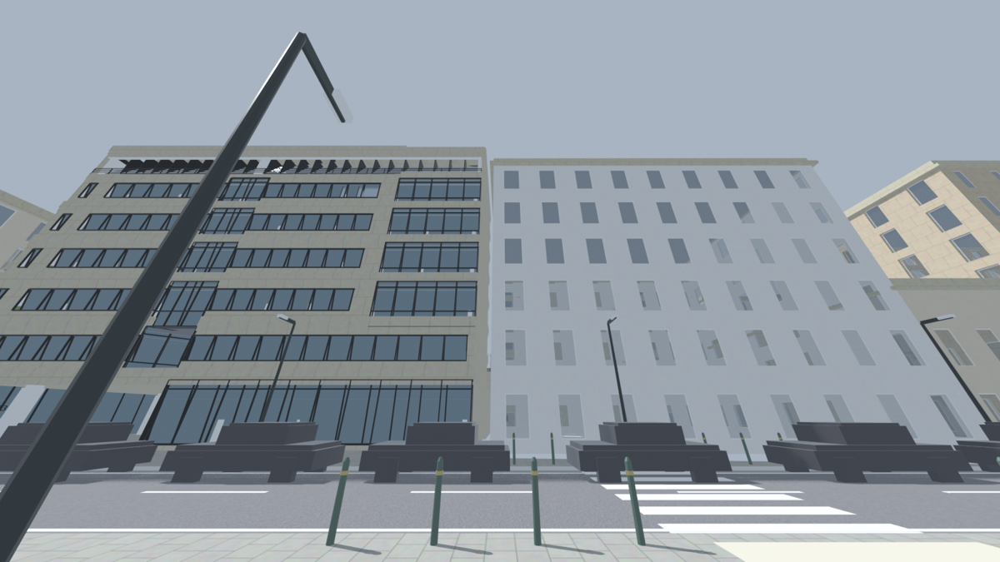 | 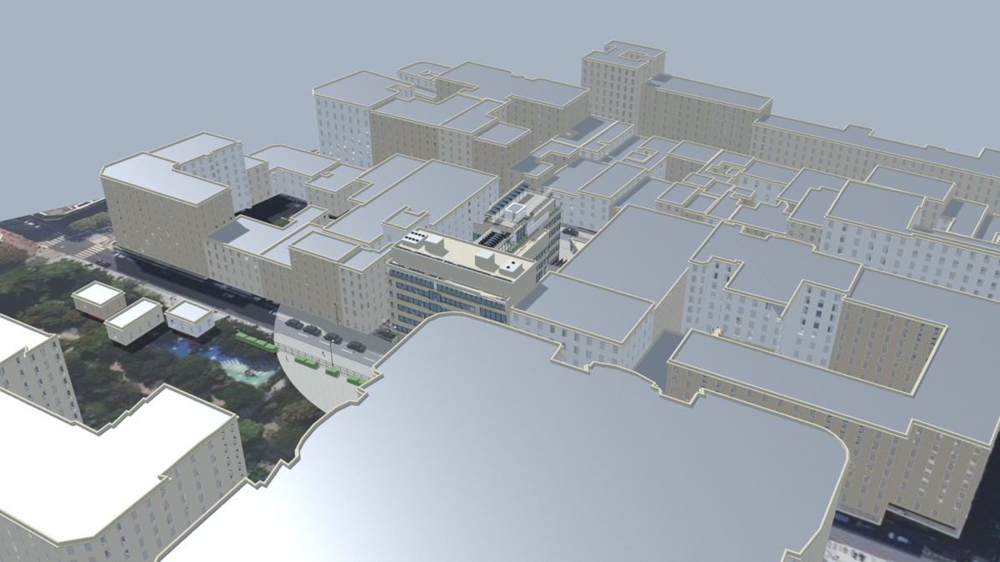 | 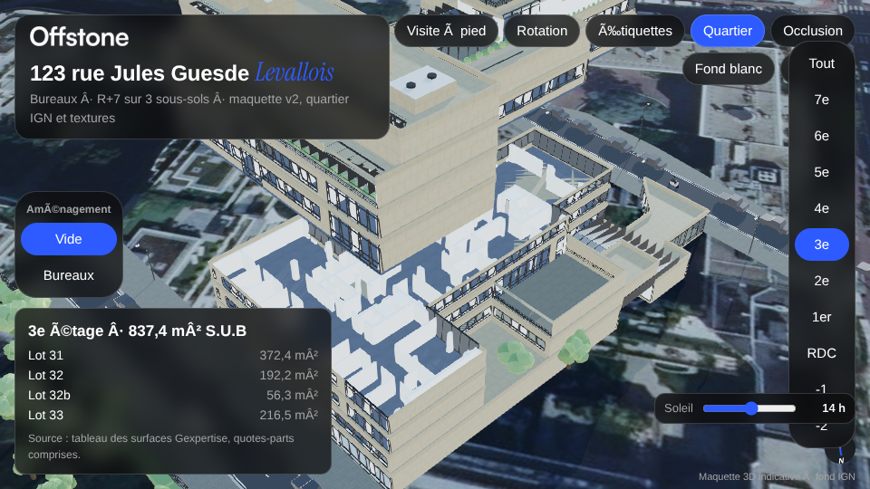 | 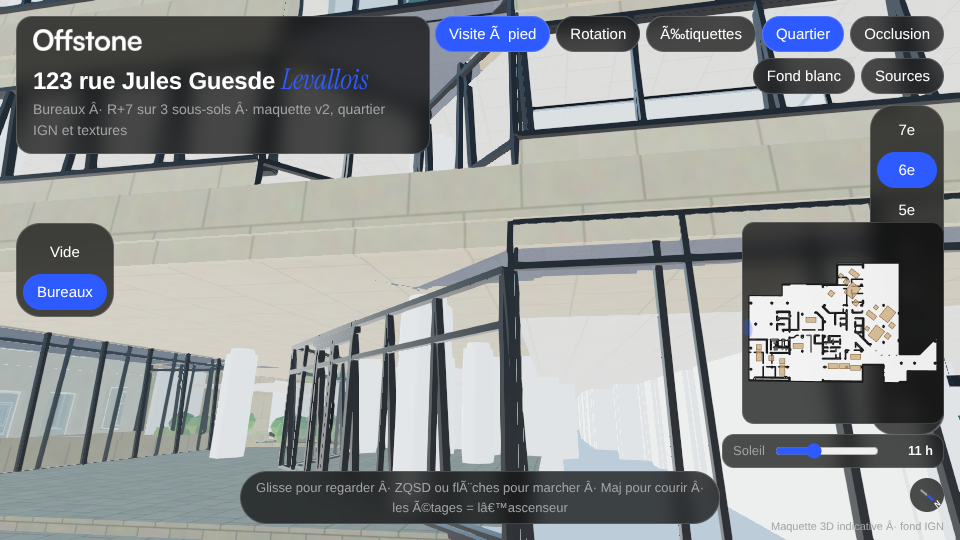 | 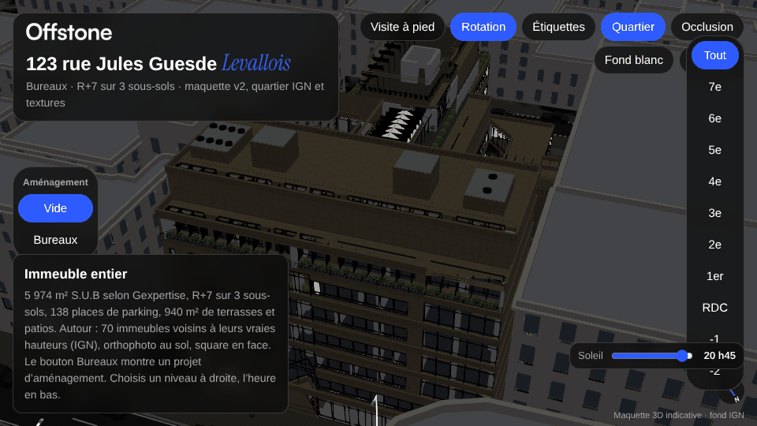 |

## Ce que la v2 ajoute à la v1

| | v1 (10 nov.) | v2 |
|---|---|---|
| Moteur | three.js r128, environnement dégradé, SSAO absent | three.js r169, ciel physique (Sky) + environnement PMREM recalculé avec le soleil, tone-mapping ACES, occlusion ambiante GTAO, SMAA, ombres douces 4096 |
| Façades | couleurs unies + motif de joints en shader | textures PBR cuites dans Blender (pierre à joints, normal + rugosité), **meneaux et traverses** en menuiserie sombre, **vitrages inclinés** comme sur les photos, verre physique à clearcoat |
| Quartier | volumes plats translucides | **70 immeubles voisins IGN BD TOPO®** à leurs vraies emprises, hauteurs et étages, façades percées, zinc en toiture |
| Sol | disque gris | **orthophoto IGN HR 520 m × 520 m** plaquée sous les rues, calée sur l'axe de la rue (tronçons routiers IGN) |
| Rue | lampadaires, potelets, trafic | + voitures garées, grille et haie du square, textures de dalles et d'enrobé |
| Lumière | soleil réel 7 h – 19 h | soleil réel 5 h – 22 h, **mode nuit** (fenêtres et lampadaires allumés) |
| Chargement | un glTF meshopt de 4,5 Mo | deux glTF Draco (extérieur 3,4 Mo puis intérieurs 2,1 Mo en différé) |
| Conservé | niveaux, lots Gexpertise, étiquettes, aménagement bureaux, visite à pied avec plan, trafic, arbres, boussole | idem, plus bouton Sources et bouton Occlusion |

## v1 réaliste (`v1-realiste/index.html`)

Artefact : https://claude.ai/artifact/DZQqf32sUeaKBVGGSCeta7. La v1 d'origine (moteur three r128, modèle meshopt, toutes ses
fonctions) avec seulement le rendu poussé, par `scripts/patch_v1_realisme.py` appliqué au code source de la v1 : ciel physique et
environnement recalculé avec le soleil, tone-mapping ACES, textures PBR projetées en triplanaire (pierre, dalles, enrobé, enduit,
zinc, moquette, faux plafond), verre physique à clearcoat, occlusion ambiante SSAO (bouton), orthophoto IGN au sol à la place du
socle, voisins opaques, soleil 5 h – 22 h avec nuit (fenêtres et lampadaires allumés).

| Ensemble | Niveau 3 | Nuit | Visite |
|---|---|---|---|
| 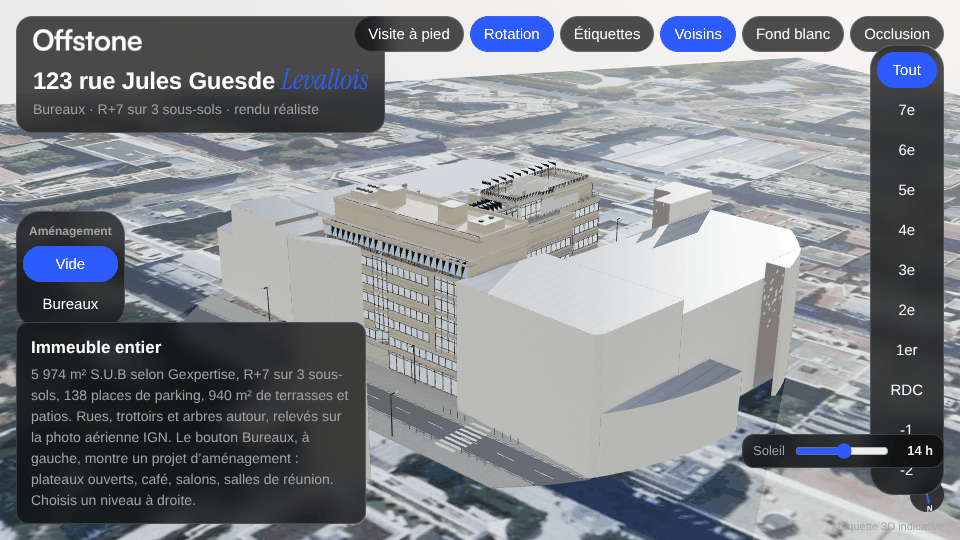 | 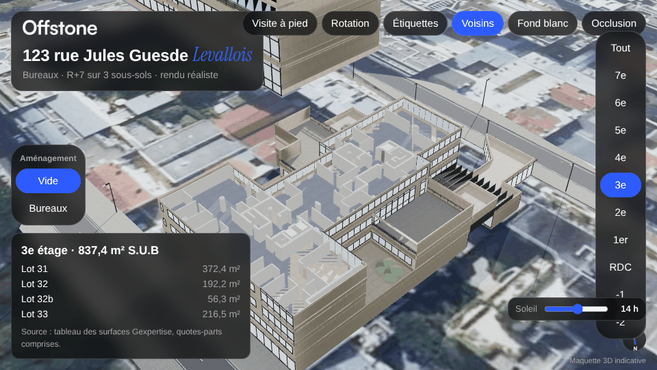 | 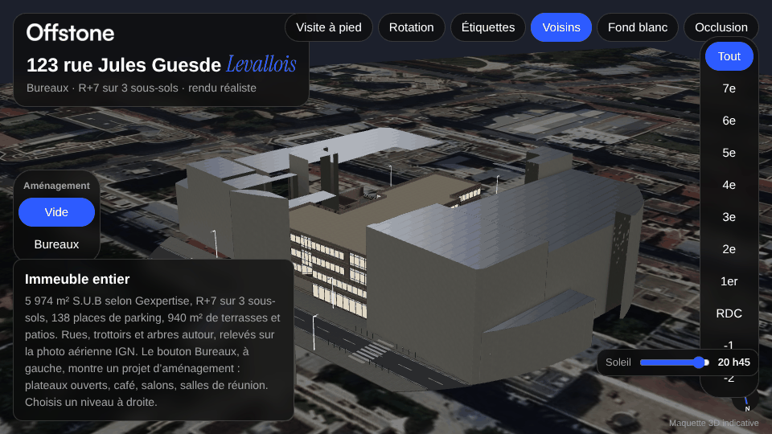 | 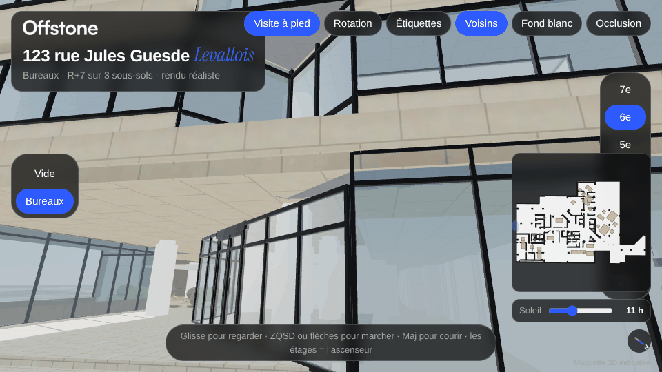 |

## Téléphone

Sous 700 px de large, la page passe en mode léger : rendu direct sans post-traitement, ombres 1024, textures 512 px, orthophoto 1024,
voisins au-delà de 95 m masqués, intérieurs chargés seulement quand on choisit un niveau ou la visite, message explicite si WebGL
échoue. L'interface se réduit à une barre (Menu, Visite, Soleil), un bandeau de niveaux défilant et une pastille qui déplie la fiche.

| Ensemble | Menu | Niveau et fiche | Visite |
|---|---|---|---|
| 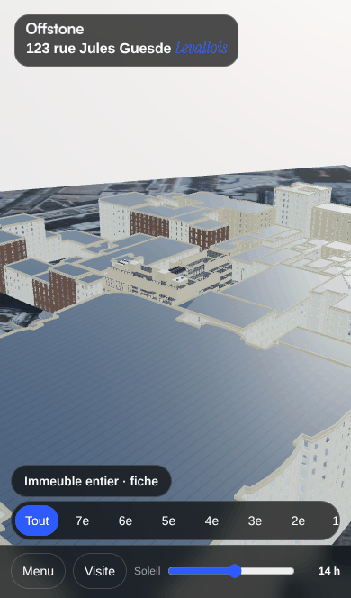 | 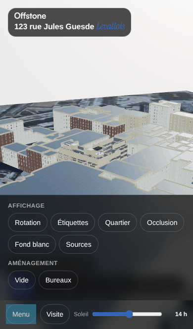 | 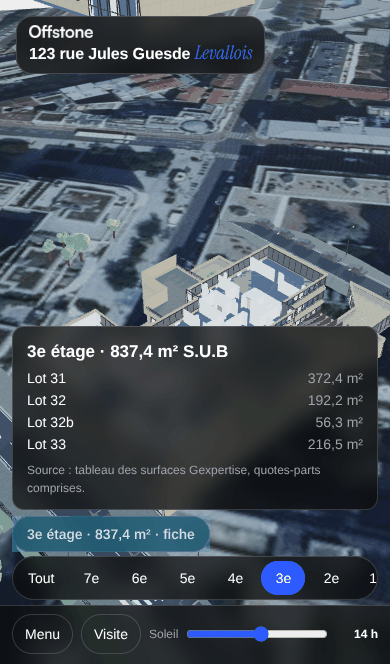 | 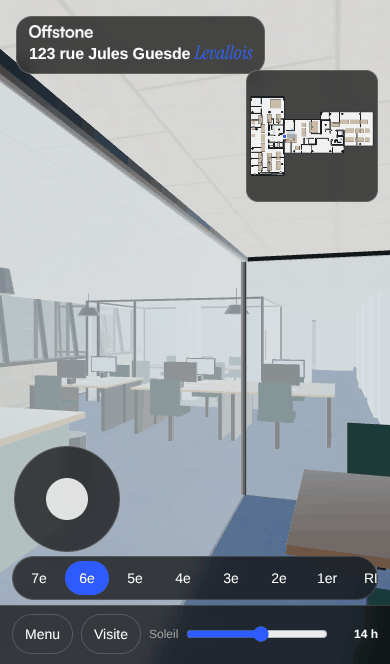 |

## Sources

- Immeuble : géométrie de la v1 (plans Gexpertise), photos des annonces CBRE et Cushman & Wakefield (`captures/photos_annonces.jpg`) pour les matériaux : panneaux de pierre beige, bandeaux vitrés inclinés à menuiserie noire, colonne en béton lavé, auvent perforé, square arboré en face.
- IGN BD TOPO® bâtiments et tronçons de route, IGN orthophoto HR (WFS/WMS data.geopf.fr).
- Google Earth / Street View n'ont pas d'API ouverte : les façades sont reconstituées.

## Reproduire

```bash
# depuis blender/ (binaire Blender requis pour décoder le glTF meshopt de la v1 et compresser en Draco)
/opt/blender/blender -b --python examples/real/123-jules-guesde-levallois/scripts/inspect_v1.py       # import v1
/opt/blender/blender -b --python examples/real/123-jules-guesde-levallois/scripts/bake_textures.py # textures PBR
/opt/blender/blender -b --python examples/real/123-jules-guesde-levallois/scripts/build_v2.py      # voisins IGN, ortho, meneaux, voitures, UV
/opt/blender/blender -b --python examples/real/123-jules-guesde-levallois/scripts/fix_v2.py && /opt/blender/blender -b --python examples/real/123-jules-guesde-levallois/scripts/export_v2.py
```

Les chemins de travail sont codés en dur dans les scripts (dossier de session) : les adapter avant de relancer. `index.html` est la page
publiée ; `scripts/index.template.html` est son gabarit (données ROOMS / FICHE / Z / TRAF injectées depuis la v1).
