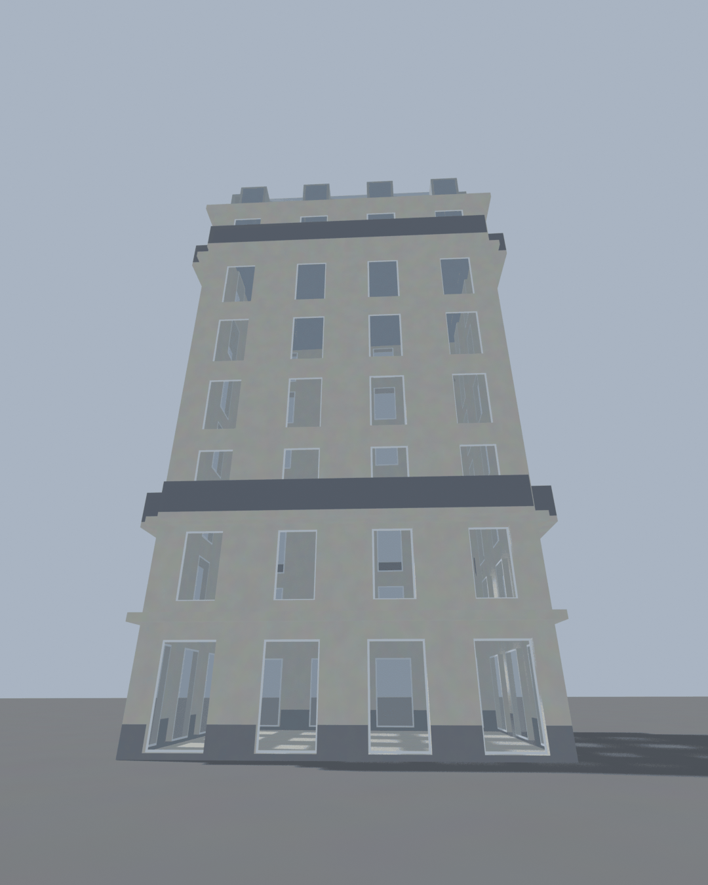
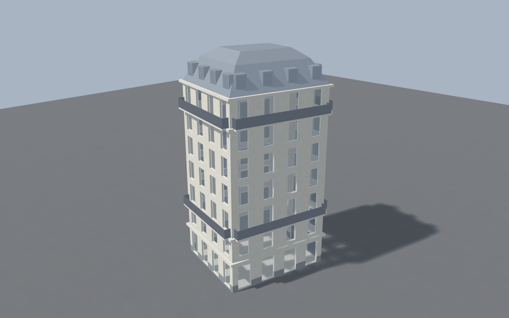
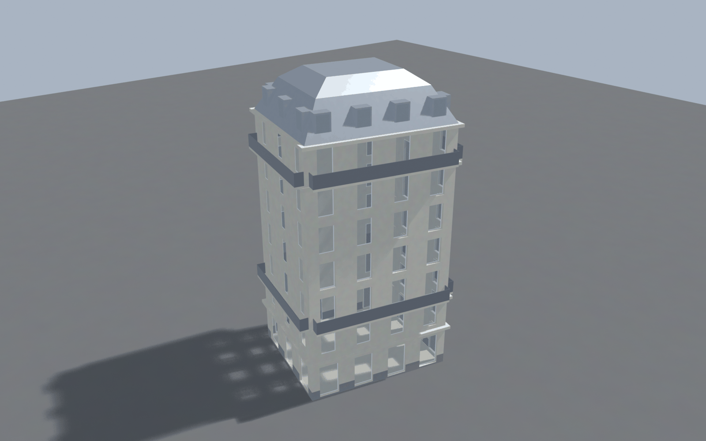
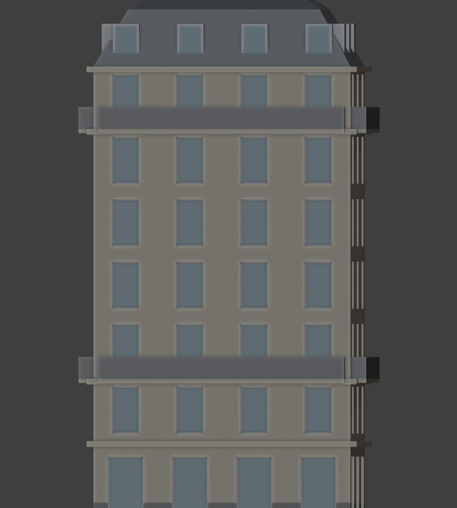
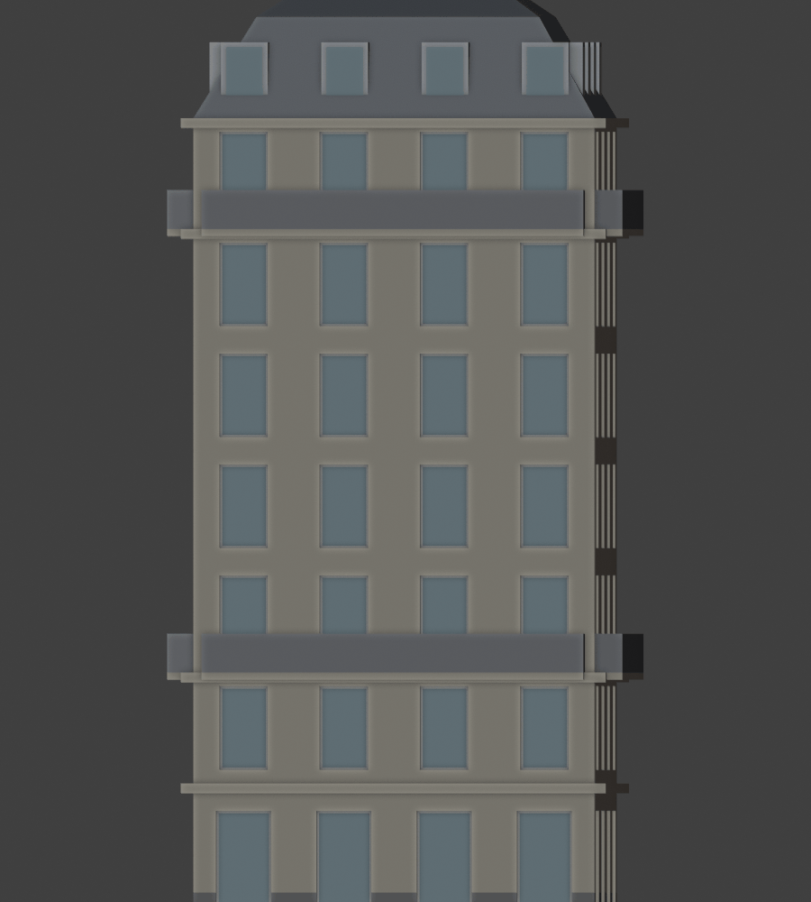
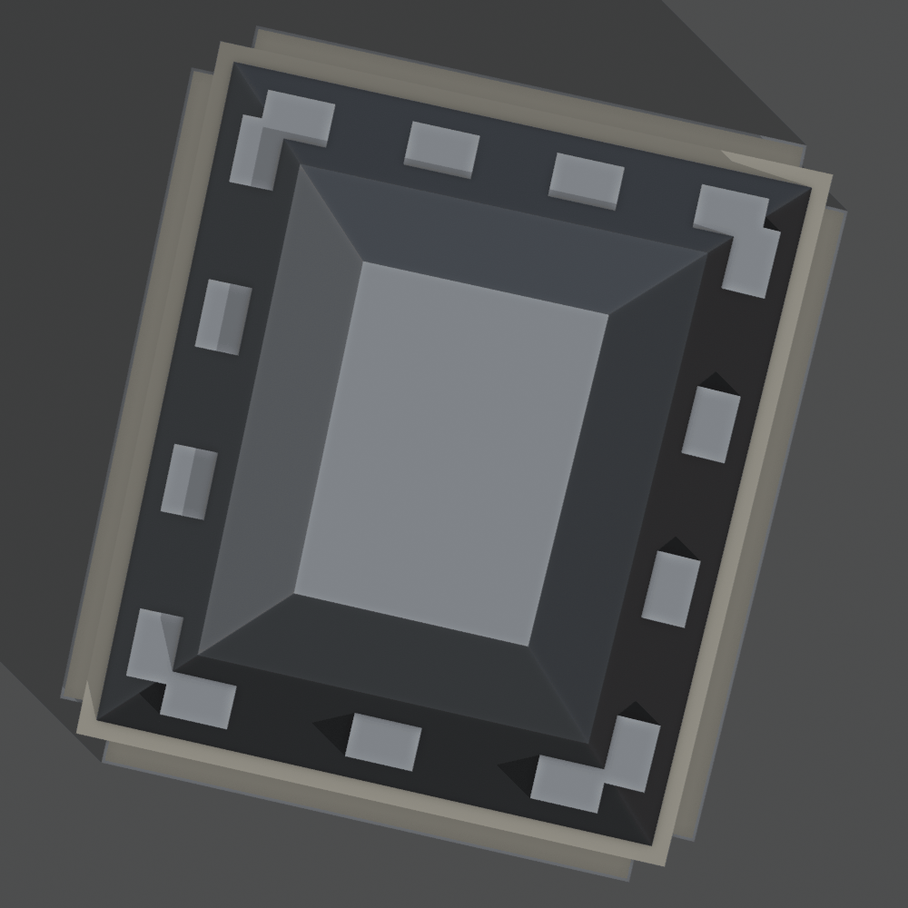

# 8 rue Pasquier, 75008 Paris — modélisation à partir des données réelles

Produit par `blender-buildings site --address "8 rue Pasquier 75008 Paris"` (ou l'outil MCP `build_from_address`).

Le bâtiment **seul** (sans les voisins), sur un sol neutre.

| Vue piéton depuis la rue Pasquier | Perspective 3/4 |
|---|---|
|  |  |

| Arrière (cour) | Élévation façade rue | Élévation pignon sud | Plan de toiture |
|---|---|---|---|
|  |  |  |  |

## Données utilisées

| Donnée | Valeur | Source |
|---|---|---|
| Géocodage | 48.871669 N, 2.323260 E | Base Adresse Nationale |
| Emprise au sol | quadrilatère de 119,6 m² (≈ 11,8 m sur rue × 10,3 m), orientée nord-sud à 12° | IGN BD TOPO® (origine cadastre), bâtiment `BATIMENT0000000245199643`, RNB `GHV52RF7EM8M` |
| Hauteur à l'égout | 20,7 m (sol 31,1 m NGF, toit 51,8 m) | IGN BD TOPO® |
| Niveaux | 7 (R+6) | IGN BD TOPO® ; MeilleursAgents indique « 6 étages » |
| Usage | commercial et services (sièges de sociétés, immeuble de bureaux) | IGN BD TOPO®, Societe.com |
| Parcelle | section BS n° 32, 119 m² (le bâtiment occupe toute la parcelle : CES = 1) | IGN Parcellaire Express |
| Période de construction | 1801 – 1850 (Louis-Philippe), rue ouverte en 1792, élargie à 12 m en 1839 | Bercail (cadastre), Wikipédia « Rue Pasquier » |
| Travaux récents | ravalement côté cour (2024), étanchéité de terrasse (2020) | Bercail (déclarations préalables) |
| OpenStreetMap | way/67559065, pas de hauteur ni de date renseignée | Overpass |
| Orientation | façade sur rue à l'ouest (azimut de vue 261°), rue de 12 m | déduite du point adresse et de l'emprise |
| Prix | ~12 075 €/m² (juin 2026) | MeilleursAgents |

Google Earth et Street View n'ont pas d'accès programmatique ouvert : la vue piéton est reconstituée à partir de
l'orientation de la façade (point adresse → centre du bâtiment) et de la largeur de rue (12 m). L'emprise, la hauteur,
les étages et les voisins sont les données officielles ; le dessin de la façade (4 travées de 2,9 m, fenêtres percées,
balcons filants au 2e et au 6e, corniches, soubassement, comble mansardé en zinc avec lucarnes) est une reconstitution
paramétrique de style parisien pré-haussmannien, à ajuster avec `--set` ou `overrides` (ex. `--set balconies.floors=[2]`).

## Métriques (voir `metrics.json`)

- Emprise 119,6 m², surface de plancher ≈ 837 m², surface utile ≈ 712 m² ;
- façades ≈ 909 m² dont ≈ 30 % vitrées, 24 fenêtres d'étage ;
- hauteur totale modélisée 24,3 m (20,7 m + comble) ; CES 1,0 ; densité 7,0.

## Fichiers

- `spec_8_rue_pasquier.json` : spec paramétrique du bâtiment (rejouable avec `blender-buildings build --spec …`) ;
- `8_rue_pasquier.glb`, `8_rue_pasquier.fbx`, `8_rue_pasquier.blend` : le bâtiment seul (ouvrable dans Blender, Three.js, Unity, Twinmotion…) ;
- `metrics.json` : métriques et résumé de construction.

Pour régénérer : `blender-buildings site --address "8 rue Pasquier 75008 Paris" --no-context --no-ortho --out output/pasquier --formats glb,fbx,blend,png --views street,perspective,elevation`.
Avec `--radius 90` (sans `--no-context --no-ortho`), on obtient en plus les 43 voisins et l'orthophoto IGN au sol.
